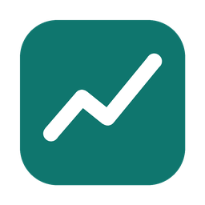

<p align="center"></p>

<h1 align="center">Ballast</h1>

<p align="center"><b>Keep your portfolio steady. Backtest strategies on real price history, get rebalancing advice, and rehearse on an Alpaca paper account.</b><br>
A Mac app that keeps itself up to date. Private: only people with access to this repository can see or download it.</p>

Describe a trading idea in plain English, read and edit the code it produces, and backtest it on every daily bar the market has. The Rebalance tab tells you which trades bring your holdings back to target. It only ever gives advice; you place any real trades yourself. The optional autopilot runs the same rebalancing rules on an Alpaca **paper** account (real prices, pretend money), so you can see how a strategy behaves before risking anything.

## Install it on a Mac

Nothing else to install: the app carries everything it needs.

1. Sign in to GitHub, open this repository's **Actions** tab, and click the latest **CI** run with a green check.
2. Under **Artifacts**, click **Ballast-mac**. Open the downloaded zip, then `Ballast.dmg`, and drag **Ballast** into **Applications**.
3. Open Ballast. The first time, macOS says it can't check the app because it isn't from the App Store: open **System Settings → Privacy & Security**, scroll down, and click **Open Anyway** next to Ballast. (On macOS 14 and earlier, right-click the app and choose **Open** instead.) You only do this once.
4. Ballast asks for its optional keys. Fill in any you have, or click **Cancel** and add them later from **Ballast → Edit Keys…**:
   - **Alpaca paper keys** switch stock prices to Alpaca's official feed and turn on the paper autopilot. Use a paper account that nothing else is trading in.
   - **Anthropic key** turns on the Claude strategy builder.

Keys, the autopilot's settings and its log are kept in `~/Library/Application Support/Ballast` on your Mac, never in the app or this repository. **Help → Show Ballast Folder** opens it. You enter keys once: every copy of Ballast on the Mac shares them, and updates and reinstalls keep them. When you save keys, Ballast checks them with Alpaca and Anthropic and tells you right away if one is rejected.

### Automatic updates (one-time setup)

Ballast updates itself, like any other app, once it has a read-only key for this private repository:

1. On GitHub, open **Settings → Developer settings → Personal access tokens → Fine-grained tokens → Generate new token** ([direct link](https://github.com/settings/personal-access-tokens/new)).
2. Name it `Ballast updates`, set **Expiration** to the longest option, and under **Repository access** choose **Only select repositories → ballast**.
3. Under **Permissions → Repository permissions**, set **Actions** to **Read-only**. Leave everything else as it is, then click **Generate token** and copy it.
4. In Ballast, choose **Ballast → Edit Keys…**, paste it into **GitHub update token**, and click **Save**.

From then on, Ballast checks for a newer build when you open it and every hour. When it finds one, it downloads it, waits for the autopilot to finish any check in progress, swaps itself out and reopens, usually within a minute. Your keys and data stay where they are. **Ballast → Check for Updates…** checks right away. The token can only read this repository's builds, and it's stored with your other keys on your Mac. If it expires, make a new one the same way.

Without a token, update by downloading the newest `Ballast.dmg` as in steps 1 and 2 above and dragging it into Applications again.

Closing the window hides it and keeps the autopilot running; **Quit** (Cmd-Q) stops it. The server's log is under **Help → Open Server Log**.

## Run it from source

For working on Ballast itself. Needs [Node.js](https://nodejs.org) 20.12 or newer.

```bash
npm install
npm start
```

Then open http://127.0.0.1:5173. Set `PORT` to use a different port. Keys go in `.env` in this folder (copy `.env.example`; git ignores `.env`). On a Mac without that file, the server uses the keys saved in the Mac app.

To get a Mac app that runs from your clone and updates itself from `main` (it uses your Git sign-in to pull), run `./app/macos/install.sh` from the clone, or `./app/macos/build.sh` to rebuild it after changing `app/macos`.

Opened without its server (for example `public/index.html` straight from disk), the page still works with fewer features: live data covers only crypto pairs from Coinbase, stock symbols use simulated data, and the Claude builder and autopilot are off.

### Market data

Live data works out of the box, with no API keys:

| Symbols | Example | Source |
|---|---|---|
| Stocks, ETFs | `AAPL`, `SPY`, `QQQ` | Yahoo Finance public chart endpoint |
| Indices | `^GSPC`, `^IXIC` | Yahoo Finance |
| Crypto pairs | `BTC-USD`, `ETH-USD`, `SOL-USD` | Coinbase Exchange public API |

The Yahoo Finance endpoint is unofficial. It works without a key, but it can rate-limit or change without notice, and stock quotes may be delayed. For an official stock feed, create a free [Alpaca](https://alpaca.markets) account and start the server with its keys:

```bash
ALPACA_API_KEY_ID=... ALPACA_API_SECRET_KEY=... npm start
```

That switches stocks to Alpaca's free real-time IEX feed. If you have a paid Alpaca data plan, set `ALPACA_FEED=sip` for consolidated quotes from all US exchanges. Crypto always comes from Coinbase.

Backtests default to **Max** history, meaning every daily bar the source has: for example AAPL from 1980, SPY from 1993, the S&P 500 index (`^GSPC`) from 1927, and BTC-USD on Coinbase from 2015. Alpaca stock history starts in 2016. Use the History menu to limit a test to 1, 3, 5, 10 or 20 years. Charts switch to a log scale when prices span more than 10x.

Yahoo prices are adjusted for splits but not dividends, so buy & hold and strategy returns leave out dividend income. Index symbols like `^GSPC` are price indices with no dividends at all.

The Monitor tab polls quotes every 2 to 60 seconds and updates the current day's bar, so paper strategies react to intraday prices. A strategy's entry and exit rules act at most once per daily bar, while stop losses and take profits can trigger at any update.

### Optional: AI strategy builder

Without an API key, plain-English prompts go to a built-in builder that understands common setups: SMA/EMA crossovers, RSI, Bollinger Bands, MACD, breakouts, stop losses and take profits.

To have Claude write strategies from any description, and edit existing ones, start the server with an Anthropic API key:

```bash
ANTHROPIC_API_KEY=sk-ant-... npm start
```

Requests use `claude-opus-5-5` with server-side refusal fallback enabled. If a request fails, the app falls back to the built-in builder.

## Features

- **Build & Test**: chat-style strategy builder, editable code, and a backtest on daily bars. The backtest reports total return vs. buy & hold, CAGR, max drawdown, Sharpe, win rate, profit factor and time in market, with an equity curve, a price chart with trade markers, and a trade list you can export as CSV.
- **Data**: live market history by default. You can also import a CSV with `Date` and `Close` columns (`Open`, `High`, `Low` and `Volume` are optional), or switch to a simulated series for offline use.
- **Rebalance**: enter your holdings, cash and target percentages. Prices refresh every 15 seconds. When any holding drifts more than your band (5 percentage points by default) from its target, you get a notification and a suggested list of trades that brings every holding back to target. Sells come first so they fund the buys, and you can set a cash buffer, a minimum trade size, and whole or fractional shares. Copy the list or export it as CSV, place the trades at your broker yourself, then click **I placed these trades** to update your holdings. The rebalancer only gives advice and never places orders.
- **Monitor**: a watchlist with live quotes, price alerts (with browser notifications), paper-trading strategies with live P&L, and an activity log. A simulated feed is available for when markets are closed or you're offline.
- **Library**: starter strategies plus the ones you save.

Saved strategies, the watchlist, alerts and paper positions are stored in your browser's local storage.

## Paper rebalancing test (Alpaca)

The autopilot runs the Rebalance tab's logic automatically on an **Alpaca paper-trading** account: real market prices, simulated money. The trading client only connects to `paper-api.alpaca.markets` and refuses any other host, so it cannot place real-money orders.

### Set up (once)

1. Create a free account at [alpaca.markets](https://alpaca.markets) and open the **Paper Trading** dashboard. If you like, reset the paper balance to the amount you'd actually invest, so the numbers feel real.
2. Generate **paper** API keys.
3. Add them in the Mac app with **Ballast → Edit Keys…** (or, running from source, in `.env`).
4. Open the **Rebalance** tab, set your targets and rules, then click **Use targets & rules above** in the autopilot panel.
5. Click **Turn on**. To start straight away instead of at tomorrow's check, click **Run check now** during market hours. The first check invests the paper cash at your targets and marks the start of the test.

### How it runs

- **Once per market day**, after the check time (10:30 ET by default), it compares the paper account with your targets. It trades only if a holding is outside the band, or if you hold something that isn't in your targets. Sells go first, then buys; ETFs that allow it are bought in fractional dollar amounts.
- **Safety checks.** Before trading, it confirms the market is open and that there are no pending orders. It skips the day if its price quote differs from Alpaca's by more than 10%, and refuses any single order over 75% of equity. After three errors in a day, it stops until the next day.
- **Logging.** Every check, order, fill and error goes to `autopilot-data/journal.jsonl` (in the Mac app, inside the Ballast folder) and the panel's decision log.

It has to be running to do its job. Either:

- leave the Ballast app (or `npm start`) running; the server checks every 5 minutes, or
- schedule `npm run autopilot -- once` every 15 minutes on weekdays. It does nothing unless a check is due, so running it often is harmless.
  - **macOS / Linux** (`crontab -e`): `*/15 * * * 1-5 cd /path/to/ballast && npm run autopilot -- once >> autopilot-data/cron.log 2>&1`
  - **Windows**: in Task Scheduler, create a task that repeats every 15 minutes and runs `node autopilot-cli.js once` with "Start in" set to this folder.

If the computer is asleep at check time, that day's check runs when it wakes, provided the market is still open. Fully missed days are counted in the report.

### Commands

```bash
npm run autopilot -- status    # account, positions, recent decisions
npm run autopilot -- report    # results vs. benchmarks, saved to autopilot-data/
npm run autopilot -- stop      # emergency stop: no orders until "resume"
npm run autopilot -- resume
npm run autopilot -- disable   # turn the daily check off
```

### Several strategies at once

To compare strategies, give each one its own paper account (create more from the Alpaca paper dashboard, then generate keys for each) and its own folder:

1. Create a folder `paper-test-<name>` holding a `config.json` like `autopilot-data/config.json` (it can be copied from there): your targets, `"enabled": true`, `"startedAt": null`, `"startEquity": null`, no `accountId`, and `"alpacaKeyPrefix": "ALPACA_<name>"`.
2. Add `ALPACA_<name>_API_KEY_ID` and `ALPACA_<name>_API_SECRET_KEY` for that account to `.env` or the environment.
3. `npm run autopilot -- cloud-run-all` runs every folder, each with its own keys.

`"rebalance": "monthly"` rebalances to target at the first check of each month instead of using the band. Each folder is pinned to the account it started on, and a folder without its own keys is skipped rather than falling back to another account.

### Judging the test at month 5

The report compares three portfolios that start from the same money on the same day: the autopilot, the same targets never rebalanced, and SPY alone. Five months is too short to judge returns, and rebalancing is about controlling risk more than adding return. So judge mostly on whether the tool behaved:

- Every order filled, and every error in the journal has an explanation.
- It traded only when something was out of band, and roughly as often as you expected.
- Slippage against the planned price stayed small (a few basis points for liquid ETFs).
- Missed days were explained by the computer being off, not by silent failures.
- You were comfortable not checking it.

If all of that holds, the next step is a small real-money amount, but only once your employer's rules allow automated trading.

## Strategy code format

A strategy is the body of a function that receives `data` and `ta` and returns entry and exit rules:

```js
const fast = ta.ema(data.close, 9);
const slow = ta.ema(data.close, 21);

return {
  entry: (i) => ta.crossover(fast, slow, i),
  exit: (i) => ta.crossunder(fast, slow, i),
  stopLoss: 0.03,   // optional, 3% below entry
  takeProfit: 0.06, // optional, 6% above entry
};
```

- `data` has aligned arrays: `time`, `open`, `high`, `low`, `close`, `volume`.
- Rules are checked at each bar's close. Orders fill at the next bar's open. Stops and targets are checked against each bar's high and low.
- Positions are long-only and all-in. Fees and slippage are set in basis points.
- Helpers: `ta.sma`, `ta.ema`, `ta.rsi`, `ta.stdev`, `ta.roc`, `ta.bollinger`, `ta.macd`, `ta.atr`, `ta.highest`, `ta.lowest`, `ta.crossover`, `ta.crossunder`.

Strategy code runs in your browser, so review AI-generated code before running it.

## Disclaimer

For research and education only. Backtests on historical or simulated data do not predict future results, and nothing here is investment advice.
